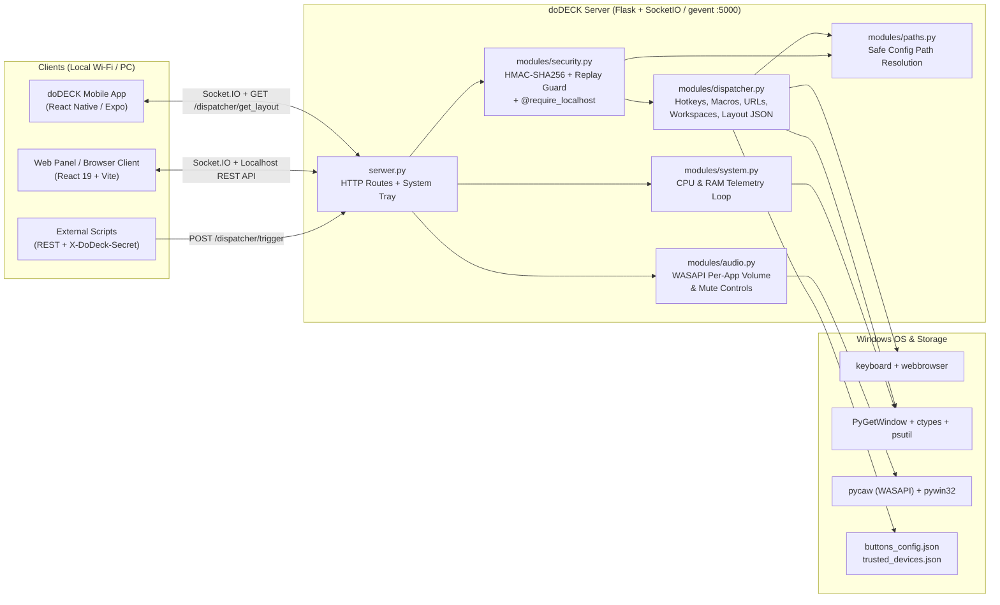

# doDECK Server (doDECK-serwer)

[](https://www.python.org/)
[](https://flask.palletsprojects.com/)
[](https://flask-socketio.readthedocs.io/)
[](https://react.dev/)
[](https://www.typescriptlang.org/)
[](https://github.com/Dudek03/doDECK-serwer/actions)

**doDECK Server** (originally *TabletDeck*) is the Windows PC automation backend, system tray host, and bundled React visual deck editor for the **doDECK** ecosystem. It transforms an old tablet, smartphone, or browser into a wireless, programmable Stream Deck over local Wi-Fi — executing hotkeys, text typing, multi-step macros, automated desktop window workspaces, live CPU/RAM telemetry, and per-application Windows audio mixing.

> **Companion Repository:** Pair this server with the native React Native / Expo client **[doDECK-mobile](https://github.com/Dudek03/doDECK-mobile)** — or run directly from any mobile browser (iOS/Android/Web) using the built-in browser pairing QR code.

---

## Features

- **Drag-and-Drop Web Layout Editor (`web-panel/`):** Visual React + `react-grid-layout` studio served directly by Flask on `http://localhost:5000/`. Create custom `COLUMNS:ROWS` profiles (e.g., `4x4`, `8x4`, `16x8`), drag/resize tiles, configure actions, and nest folders.
- **Native Windows OS Automation (`modules/dispatcher.py`):**
  - `hotkey` — Sends global keyboard shortcuts (e.g., `win+d`, `ctrl+shift+esc`, `win+e`).
  - `write` — Types exact text snippets/macros into the focused application.
  - `open_url` — Opens validated `http://` or `https://` links in the default browser.
  - `workspace` — Scans open Windows apps (`/dispatcher/scan_windows`), saves window coordinates/sizes/executable paths, and restores or launches entire multi-window layouts with a single tap.
  - Multi-step `trigger_macro` sequences with configurable per-step millisecond delays.
- **Per-App Windows Audio Mixer (`modules/audio.py`):** Uses Windows Core Audio (`pycaw` / WASAPI + `win32api`) to list active unmuted applications, adjust individual app volumes (`0–100%`), toggle system master mute, and toggle microphone mute (`WM_APPCOMMAND`).
- **Real-Time Hardware Telemetry (`modules/system.py`):** Streams peak per-core CPU and RAM usage via `psutil` over Socket.IO (`system_update` every 3 seconds) only while clients are subscribed.
- **Zero-Trust LAN Security (`modules/security.py`):**
  - Automatically generates a 256-bit (64-character hex) secret key stored locally in `trusted_devices.json`.
  - Protects pairing, layout saving, and window scanning endpoints with `@require_localhost`.
  - Verifies every Socket.IO `trigger_action` and `trigger_macro` payload with **HMAC-SHA256**, a **±10-second** timestamp skew window, and an in-memory **15-second** signature replay cache.
  - Supports external REST automation via `/dispatcher/trigger` using either localhost or the `X-DoDeck-Secret` header.
- **Dual QR Pairing Modes:** Generates QR codes in the Web Editor for both the **[doDECK-mobile](https://github.com/Dudek03/doDECK-mobile)** app (JSON payload) and mobile/iOS browsers (`http://<LAN_IP>:5000/#secret=<key>`, keeping the key in the RFC 3986 URL fragment so it is never sent in HTTP request logs).
- **System Tray Daemon & Single-File Windows Build:** Runs silently in the Windows system tray (`pystray`) displaying the PC's LAN IP with quick actions to open the Web Editor or exit, and compiles into a standalone `DoDeckServer.exe` via PyInstaller.
- **Built-in Performance Benchmarking:** Includes both a CLI benchmark (`benchmark_performance.py`) comparing WebSocket+HMAC vs. HTTP POST latency and server CPU/RAM/handle/thread overhead, and an interactive browser benchmark at `/benchmark`.

---

## Architecture



---

## Tech Stack

| Layer | Technology |
| :--- | :--- |
| **Backend Server** | Python 3.11+, Flask `3.1`, Flask-SocketIO `5.6`, `gevent`, `gevent-websocket`, Flask-CORS |
| **Windows Automation** | `keyboard`, `PyGetWindow`, `psutil`, `pycaw`, `comtypes`, `pywin32`, `pystray`, `Pillow` |
| **Web Editor & Client** | React `19.2`, TypeScript `6.0`, Vite `8.3`, `react-grid-layout`, `qrcode.react`, `socket.io-client`, `axios`, `crypto-js` |
| **Testing** | Python `unittest` (`tests/`), Vitest + `@testing-library/react` (`web-panel/src/__tests__/`) |
| **Packaging & CI** | PyInstaller (`--onefile --noconsole`), GitHub Actions (`.github/workflows/build.yml`) |

---

## Project Structure

```text
doDECK-serwer/
├── serwer.py                     # Main Flask + Socket.IO server, static hosting, & pystray tray UI
├── run.py                        # Minimal launcher entrypoint calling start_server()
├── modules/
│   ├── __init__.py               # Blueprint registration list
│   ├── dispatcher.py             # Layout CRUD, window scanner, REST trigger, & Socket.IO action/macro handlers
│   ├── audio.py                  # Windows Core Audio (pycaw) per-app mixer, master mute, & mic mute
│   ├── system.py                 # CPU/RAM REST endpoint & background Socket.IO telemetry publisher
│   ├── security.py               # Localhost guard, LAN IP detection, 64-char secret key, & HMAC/replay verification
│   ├── paths.py                  # Safe config path resolver (CWD -> exe dir -> %APPDATA%\doDECK; avoids System32)
│   └── imageHandler.py           # Icon colorization/texturing utilities & image blueprint
├── web-panel/                    # React + TypeScript + Vite Web Editor & Browser Deck Client
│   ├── src/
│   │   ├── App.tsx               # Main app, Editor vs. Client mode, Socket.IO & HMAC signing
│   │   ├── types.ts              # Shared layout, tile, audio, and pairing types
│   │   ├── components/           # Header, DevicePreview, Tile, EditorModal, AudioMixerModal, PairingModal
│   │   └── __tests__/            # Vitest component & unit tests (4 test suites)
│   └── public/benchmark.html     # Interactive browser latency benchmark (/benchmark)
├── tests/                        # Python unittest suite (audio, dispatcher, paths, security, server, system)
├── buttons_config.json           # Default multi-profile deck layout configuration
├── benchmark_performance.py      # CLI RTT latency (WS+HMAC vs. HTTP) & process resource profiler
├── requirements.txt              # Python backend dependencies
└── .github/workflows/build.yml   # CI: Vitest + Vite build -> Python unittest -> PyInstaller DoDeckServer.exe
```

---

## Getting Started

### Prerequisites

- **Windows 10 / 11** (required for `pycaw`, `pywin32`, `PyGetWindow`, and `pystray` integration)
- **Python 3.11+**
- **Node.js 20+** and **npm** (required to build or develop `web-panel/`)

### 1. Build the Web Panel

The Flask server serves the compiled React frontend from `web-panel/dist/`.

```bash
cd web-panel
npm install
npm run build
cd ..
```

### 2. Install Python Dependencies

```bash
python -m venv venv
venv\Scripts\activate
pip install -r requirements.txt
```

### 3. Run the Server

```bash
python serwer.py
```

*(Or `python run.py`.)*

Once started:
- The server listens on `0.0.0.0:5000` (HTTP + Socket.IO).
- A green **`dD`** icon appears in the Windows system tray displaying your local LAN IP, with options to **Open Web Editor** (`http://localhost:5000/`) or **Exit doDECK**.
- On first run, `trusted_devices.json` (storing the generated 64-character pairing secret) and `buttons_config.json` are resolved via `modules/paths.py` (preferring the project directory during development, or `%APPDATA%\doDECK` when running standalone).

### Running Tests

```bash
# Backend unit tests (Python unittest)
python -m unittest discover -s tests

# Web panel unit tests (Vitest)
cd web-panel
npm test
```

### Building the Standalone Windows Executable

Matches `.github/workflows/build.yml`:

```bash
pip install pyinstaller
pyinstaller --onefile --noconsole --name DoDeckServer ^
  --add-data "web-panel/dist;web-panel/dist" ^
  --add-data "buttons_config.json;." ^
  --collect-all engineio --collect-all socketio ^
  --collect-all gevent --collect-all geventwebsocket ^
  --collect-all flask_socketio serwer.py
```

The portable executable is created at `dist/DoDeckServer.exe`.

---

## API & Socket.IO Reference

### HTTP Endpoints

| Method | Path | Access | Description |
| :--- | :--- | :--- | :--- |
| `GET` | `/` | LAN | Serves the React Web Editor (localhost) or Browser Client (LAN). |
| `GET` | `/benchmark` | LAN | Serves the interactive browser latency benchmark tool. |
| `GET` | `/api/pairing` | Localhost only | Returns `{ ip, port, secret }` for QR code generation. |
| `GET` | `/dispatcher/get_pairing_data` | Localhost only | Returns `{ ip, port, secret }` for the local Web Editor. |
| `GET` | `/dispatcher/get_layout` | LAN | Returns the active `buttons_config.json` profiles and tiles. |
| `POST` | `/dispatcher/save_layout` | Localhost only | Persists updated profiles/tiles JSON to `buttons_config.json`. |
| `GET` | `/dispatcher/scan_windows` | Localhost only | Lists visible Windows titles, positions, sizes, and executable paths for `WORKSPACE` tiles. |
| `POST` | `/dispatcher/trigger` | Localhost or `X-DoDeck-Secret` | Executes `{ "command": "...", "args": ... }` via REST. |
| `GET` | `/system/getSystemUsage` | LAN | Returns current `{ cpu, ram }` percentages. |
| `GET` | `/audio/getAppsVolume` | LAN | Lists active unmuted Windows audio sessions and volume levels. |
| `POST` | `/audio/setAppVolume` | LAN | Sets volume (`0–100`) for `{ "app": "<name>", "volume": <0-100> }`. |
| `GET` | `/audio/muteAllApps` | LAN | Toggles Windows master speaker mute. |
| `GET` | `/audio/mic3` | LAN | Toggles microphone mute via `WM_APPCOMMAND`. |

### Socket.IO Events

| Direction | Event | Auth | Payload / Behavior |
| :--- | :--- | :--- | :--- |
| Client → Server | `subscribe_telemetry` | LAN | Registers client for live CPU/RAM updates (broadcasts `system_update` every 3s). |
| Server → Client | `system_update` | — | `{ "cpu": <max_core_%>, "ram": <mem_%> }` |
| Client → Server | `trigger_action` | **HMAC-SHA256** | `{ command, args, timestamp, signature }` — executes `hotkey`, `write`, `open_url`, or `workspace`. |
| Client → Server | `trigger_macro` | **HMAC-SHA256** | `{ steps: [{ command, args, delay }], timestamp, signature }` — executes sequential steps. |
| Client → Server | `get_audio_volume` | LAN | Requests current Windows per-app audio levels. |
| Server → Client | `audio_volume_data` | — | `{ count, apps: [{ App, Volume, isMuted }] }` |
| Client → Server | `set_audio_volume` | LAN | `{ app, volume }` — adjusts an application's WASAPI volume (`0–100`). |
| Client → Server | `toggle_mute_all` | LAN | Toggles Windows master speaker mute. |
| Client → Server | `toggle_mic_mute` | LAN | Toggles Windows microphone mute. |

### Performance Benchmarking

With `serwer.py` running in a separate terminal:

```bash
python benchmark_performance.py
# Or target a specific LAN host:
python benchmark_performance.py --host http://192.168.1.100:5000
```

This measures 100-request RTT statistics (`min`, `mean`, `median`, `max`, `stdev`) for both HTTP POST and WebSocket+HMAC, plus idle vs. active-load CPU, RAM RSS, handle, and thread counts.

---

## Related Repositories

- **[doDECK-mobile](https://github.com/Dudek03/doDECK-mobile)** — Native Expo / React Native mobile & tablet client with QR pairing, live widgets, and per-app audio mixer.
